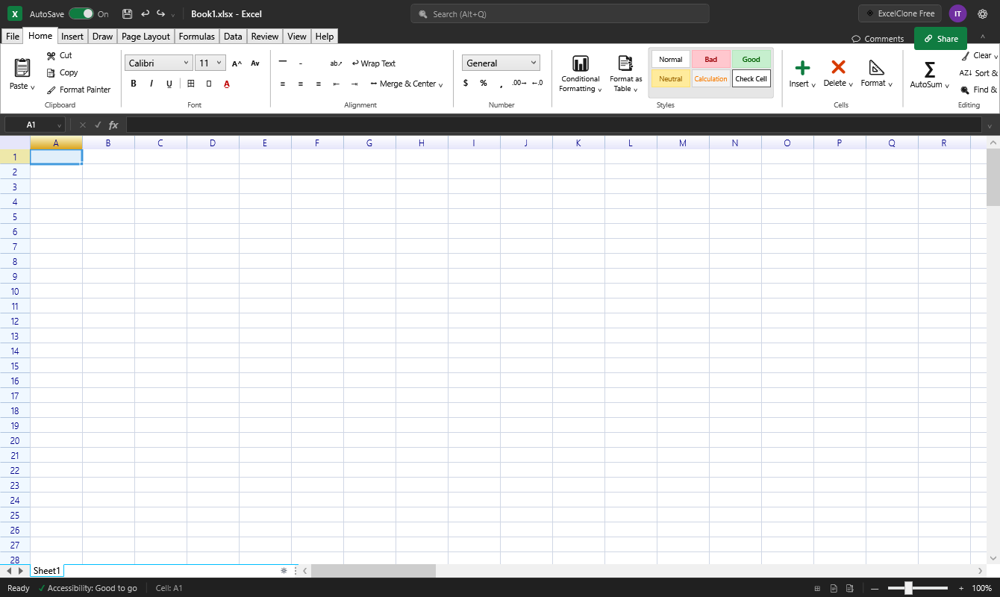

# ⚡ ExcelClone

### A Free, Open-Source Desktop Spreadsheet Application for Windows

**Your spreadsheets. Your desktop. Your freedom.**

ExcelClone is a standalone Windows desktop spreadsheet application built with C#, .NET 10, WPF, ReoGrid V3 Community Edition, and ClosedXML. It delivers a familiar, responsive spreadsheet experience with ribbon controls, robust formula calculations, charting, data manipulation tools, and OpenXML workbook interoperability — completely free, locally executed, and without mandatory accounts, activation, or subscriptions.

<p align="center">
  <a href="#-features">Features</a> •
  <a href="#-installation">Installation</a> •
  <a href="#-building-from-source">Build from Source</a> •
  <a href="#-technology-stack">Tech Stack</a> •
  <a href="#-testing">Testing</a> •
  <a href="#-contributing">Contributing</a> •
  <a href="#-licensing">Licensing</a>
</p>

---

<p align="center">
  
</p>

<p align="center">
  
  
  
  
  
</p>

---

## 📥 Quick Download (Ready-to-Run Application)

You can download and run ExcelClone directly without needing to install .NET SDK or compile from source code:

👉 **[Click Here to Download ExcelClone v2.0 Portable (.zip)](Download/ExcelClone_v2.0_Portable.zip)** *(4.55 MB)*

### How to use:
1. Download **[`ExcelClone_v2.0_Portable.zip`](Download/ExcelClone_v2.0_Portable.zip)** from the [`Download/`](Download/) folder.
2. Right-click the `.zip` file and select **Extract All...**.
3. Double-click **`ExcelClone.exe`** to run!
4. *100% Free, Offline, No Subscription, No Activation Keys.*

> **Platform Note:** ExcelClone is a native 64-bit Windows desktop application (WPF / .NET 10) for Windows 10 and 11. It is not an Android APK.

---

## ✨ Why ExcelClone?

Spreadsheet software is an essential productivity tool that should remain open, private, and accessible to everyone.

ExcelClone is engineered from the ground up as a desktop-native Windows alternative for users who want complete ownership over their files:

- 🆓 **100% Free** — No subscriptions, advertisements, or mandatory fees.
- 🔓 **Open Source** — Inspect the codebase, review security, and adapt it to your needs.
- 🖥️ **Desktop First** — Built with native WPF on modern .NET 10 for low-latency desktop editing.
- 📂 **Local & Private** — All spreadsheets reside on your local machine; zero telemetry of spreadsheet content.
- 📡 **Fully Offline** — No account login, cloud sync, or internet connection required.
- 🛡️ **Macro-Safe Architecture** — Retains `.xlsm` VBA binary packages for lossless round-tripping without executing untrusted script payloads.

---

## 🚀 Verified Features

### 📊 Spreadsheet Interface & Editing
- **Ribbon UI:** Organized into Home, Insert, Formulas, Data, View, Automation & Settings, and Help tabs.
- **Formula Bar & Name Box:** Interactive cell coordinate display, range selection, and expression editing.
- **Cell Formatting:** Custom font family, font size, bold, italic, underline, fill color, text color, and cell borders.
- **Alignment & Merging:** Horizontal/vertical alignments, text wrapping, and cell merging.
- **Number Formatting:** Currency (`$#,##0.00`), Percentage (`0.0%`), Accounting, Date/Time (`yyyy-mm-dd`), and Scientific formats.
- **Multi-Worksheet Management:** Create, rename, reorder, delete, and switch between worksheets seamlessly.

### 🧮 Formula Calculation Engine
- **Mathematical Functions:** `SUM`, `AVERAGE`, `PRODUCT`, `ROUND`, `ROUNDUP`, `ROUNDDOWN`, `ABS`, `SQRT`, `MOD`, `POWER`.
- **Statistical Functions:** `COUNT`, `COUNTA`, `COUNTIF`, `COUNTIFS`, `MAX`, `MIN`, `MEDIAN`, `STDEV`, `STDEVP`, `VAR`, `VARP`.
- **Financial Modeling:** `NPV` (Net Present Value), `IRR` (Internal Rate of Return), `PMT` (Loan Payment), `SLN` (Straight-Line Depreciation), `DB` (Declining Balance).
- **Lookup & Reference:** `VLOOKUP`, `INDEX`, `MATCH`, `XLOOKUP`, `LOOKUP`, `ROW`, `COLUMN`.
- **Logical Operations:** `IF`, `AND`, `OR`, `NOT`, `IFERROR`, `AVERAGEIF`, `AVERAGEIFS`.
- **Text Manipulation:** `CONCATENATE`, `LEN`, `UPPER`, `LOWER`, `LEFT`, `RIGHT`, `MID`, `TRIM`, `TEXT`.
- **Information Functions:** `ISBLANK`, `ISNUMBER`, `ISTEXT`, `ISERROR`, `ISNA`, `ISEVEN`, `ISODD`.
- **Matrix Calculations:** `MDETERM`, `SUMPRODUCT`, `TRANSPOSE`.
- **Cross-Sheet References:** Calculate across worksheets using standard `SheetName!A1` syntax.

### 🔬 Advanced Numerical Analysis & What-If
- **Goal Seek:** Interactive target value convergence with configurable iteration limits and step tolerances.
- **Descriptive Statistics:** Generates comprehensive summary metrics (Mean, Standard Error, Median, Mode, Variance, Standard Deviation, Kurtosis, Skewness, Range, Minimum, Maximum, and Sum) powered by [MathNet.Numerics](https://numerics.mathdotnet.com/).
- **Linear Regression:** Computes slope, intercept, R-squared ($R^2$), and standard error.

### 🧹 Data Tools & Transformation
- **Data Transformation Studio:** Integrated dialog to preview, filter rows, eliminate duplicate records, split/merge columns, and mutate data types.
- **Delimited File Import:** Import CSV and TXT files with auto-detected separators, quotes, and headers.
- **Sorting & Filtering:** Sort ascending/descending by column and apply active autofilters.
- **Templates:** Built-in starter templates for Corporate Financial Models, Inventory Catalogs, and Project Milestone Schedules.

### 📈 Charting & Visualization
- **Chart Types:** Clustered Column, Bar, Line, Pie, Scatter, and Area charts.
- **Chart Customization:** Configurable chart title, series definitions, data ranges, and legend placements.
- **Print Preview & Output:** Formatted worksheet printing with page setup and export capabilities.

---

## 📸 Interface Preview

<p align="center">
  
  <br>
  <em>ExcelClone desktop interface with ribbon controls, formula bar, and multi-sheet calculation grid.</em>
</p>

---

## 📥 Installation

ExcelClone is distributed for 64-bit Windows (Windows 10 / Windows 11).

### Option 1 — Portable Release (Recommended)

1. Go to the [GitHub Releases](https://github.com/Sandeep37-s/excel-clone/releases) page.
2. Download `ExcelClone_Portable.zip`.
3. Extract the ZIP archive to a folder on your computer.
4. Launch `ExcelClone.exe`.

*No administrative rights, installer, or background services required.*

### Option 2 — Windows Shortcut & File Association Script

To register desktop shortcuts and `.xlsx` / `.xlsm` / `.csv` file associations:

1. Download or clone this repository.
2. Open PowerShell as a standard user in the `Distribution` folder.
3. Run the installer script:
   ```powershell
   powershell -ExecutionPolicy Bypass -File Distribution\Install-ExcelClone.ps1
   ```
4. To remove shortcuts and associations at any time:
   ```powershell
   powershell -ExecutionPolicy Bypass -File Distribution\Uninstall-ExcelClone.ps1
   ```

---

## 🛠️ Building from Source

### Prerequisites
- **Operating System:** Windows 10 (version 1903+) or Windows 11.
- **SDK:** [.NET 10.0 SDK](https://dotnet.microsoft.com/download/dotnet/10.0) (10.0.200 or newer).
- **IDE:** Visual Studio 2022 (v17.13+) with the **.NET Desktop Development** workload, or VS Code with C# Dev Kit.

### Clone and Build

1. Clone the repository:
   ```bash
   git clone https://github.com/Sandeep37-s/excel-clone.git
   cd excel-clone
   ```

2. Restore NuGet dependencies:
   ```bash
   dotnet restore ExcelClone.slnx
   ```

3. Build the solution in Release mode:
   ```bash
   dotnet build ExcelClone.slnx -c Release
   ```

4. Run the application:
   ```bash
   dotnet run --project ExcelClone/ExcelClone.csproj -c Release
   ```

---

## 🧪 Automated Testing

ExcelClone includes an automated verification test suite covering core spreadsheet calculations, multi-sheet round-tripping, formatting, charts, and numerical analysis.

Run all tests from the repository root:

```bash
dotnet test ExcelClone.slnx -c Release
```

### Verified Test Categories:
- **Core Formula Audits:** Validates 500+ standard formula permutations against expected OpenXML outputs.
- **Genuine Cross-Platform Compatibility:** Verifies roundtrip loading and editing of workbooks created in Microsoft Excel, LibreOffice Calc, and Google Sheets.
- **VBA Macro Preservation:** Confirms `xl/vbaProject.bin` packages are preserved byte-for-byte in `.xlsm` workbooks without executing macro code.
- **Settings & Standalone Operation:** Ensures user preferences (theme, auto-save interval, calc mode) persist locally without network requests.

---

## 🧰 Technology Stack

| Component | Technology | Role |
| :--- | :--- | :--- |
| **Language** | C# 13 | Primary application logic |
| **Framework** | .NET 10 | High-performance runtime & base class libraries |
| **GUI Framework** | WPF / XAML | Hardware-accelerated desktop interface & Per-Monitor V2 High DPI |
| **Spreadsheet Engine** | Syncfusion SfSpreadsheet for WPF | Grid virtualization, cell rendering, and ribbon controls |
| **OpenXML Engine** | Syncfusion XlsIO | Lossless `.xlsx`, `.xlsm`, and `.csv` parsing and serialization |
| **Numerical Library** | MathNet.Numerics 5.0 | Descriptive statistics, regression, and Goal Seek algorithms |
| **Testing** | xUnit & Microsoft.NET.Test.Sdk | Automated unit and integration regression test suite |

---

## 🗺️ Roadmap

- [x] High-performance WPF spreadsheet foundation on modern .NET 10.
- [x] Comprehensive ribbon bar and formula bar integration.
- [x] Multi-sheet OpenXML workbook loading, editing, and saving.
- [x] 500+ formula audit and calculation engine verification.
- [x] Charting (Column, Bar, Line, Pie, Scatter) and data visualization.
- [x] Goal Seek, Descriptive Statistics, and Linear Regression tools.
- [x] Data transformation module (deduplication, column splitting/merging).
- [x] Removal of all mandatory authentication, login screens, and cloud servers.
- [x] Consolidated portable distribution archive and clean installer scripts.
- [x] Decoupled project directory and namespaces to clean `ExcelClone`.
- [ ] Extended Dynamic Array formula spilling support (`FILTER`, `UNIQUE`, `SORT`, `SEQUENCE`).
- [ ] Slicers and timeline controls for PivotTables.
- [ ] Dark theme refinement and accessibility enhancements.

---

## ⚠️ Known Limitations & Compatibility Disclaimers

> [!IMPORTANT]
> - **Excel Compatibility Scope:** ExcelClone is an independent spreadsheet application built with modern .NET and Syncfusion XlsIO. While it delivers high OpenXML (`.xlsx`) fidelity, it is **not** an exhaustive 1:1 clone of Microsoft 365:
>   - **Dynamic Spill Arrays:** Formulas such as `=FILTER()`, `=UNIQUE()`, and `=SORT()` that spill dynamic ranges across multiple adjacent cells are not natively calculated as spill matrices; standard functions (`SUM`, `AVERAGE`, `VLOOKUP`, `INDEX/MATCH`, `IF`, etc.) are fully supported.
>   - **Power Query & Data Model:** Excel Data Models, Power Pivot DAX models, and Power Query (M-language) ETL connections are not executed or refreshed locally.
>   - **Macro Execution:** For user security, VBA macro script execution is deliberately disabled. Workbooks containing macros (`.xlsm`) can be opened, edited, and saved with complete preservation of their underlying VBA binary streams, but macros will not execute.
> - **Syncfusion Licensing & Evaluation Warning:** 
>   - ExcelClone utilizes Syncfusion Essential Studio for WPF.
>   - When running without a registered license key, Syncfusion operates in Evaluation mode, displaying a startup notice and inserting an `"Evaluation Warning"` sheet into saved workbooks.
>   - Users or organizations can permanently remove the evaluation sheet by obtaining a free [Syncfusion Community License](https://www.syncfusion.com/products/communitylicense) and saving their key in **Settings > License Key** or the `SYNCFUSION_LICENSE_KEY` environment variable.
> - **Trademark Notice:** Microsoft Excel is a registered trademark of Microsoft Corporation. ExcelClone is an independent open-source project and is not affiliated with, endorsed by, or sponsored by Microsoft Corporation.

---

## 🤝 Contributing

Contributions to ExcelClone are welcome!

Whether fixing bugs, expanding formula coverage, refining the UI, or improving documentation:

1. **Fork** the repository on GitHub.
2. **Clone** your fork locally:
   ```bash
   git clone https://github.com/YOUR_USERNAME/excel-clone.git
   ```
3. Create a descriptive feature branch:
   ```bash
   git checkout -b feature/formula-improvement
   ```
4. Commit your changes with clear messages:
   ```bash
   git commit -m "Add: support for MEDIAN formula edge-cases"
   ```
5. Ensure all tests pass:
   ```bash
   dotnet test ExcelClone.slnx -c Release
   ```
6. Push to your branch and submit a **Pull Request**.

---

## 🔐 Security

Security and user privacy are foundational principles of ExcelClone. 

If you discover a potential vulnerability, please report it privately according to our [SECURITY.md](SECURITY.md) guidelines rather than opening a public issue.

---

## 📄 Licensing

- **ExcelClone Application Code:** Released under the [MIT License](LICENSE).
- **Core Spreadsheet Components:**
  - **ReoGrid V3 Community Edition:** Licensed under the [MIT License](https://github.com/unvell/ReoGrid).
  - **ClosedXML:** Licensed under the [MIT License](https://github.com/ClosedXML/ClosedXML).
  - **DocumentFormat.OpenXml:** Licensed under the [MIT License](https://github.com/dotnet/Open-XML-SDK).
  - **MathNet.Numerics:** Licensed under the [MIT License](https://numerics.mathdotnet.com/License.html).
- For complete third-party dependency details, see [THIRD_PARTY_NOTICES.md](THIRD_PARTY_NOTICES.md).

---

<p align="center">
  <strong>Built with ❤️ for spreadsheet users who value privacy, speed, and ownership.</strong>
  <br>
  <sub>ExcelClone — Free. Open source. Desktop first.</sub>
</p>

